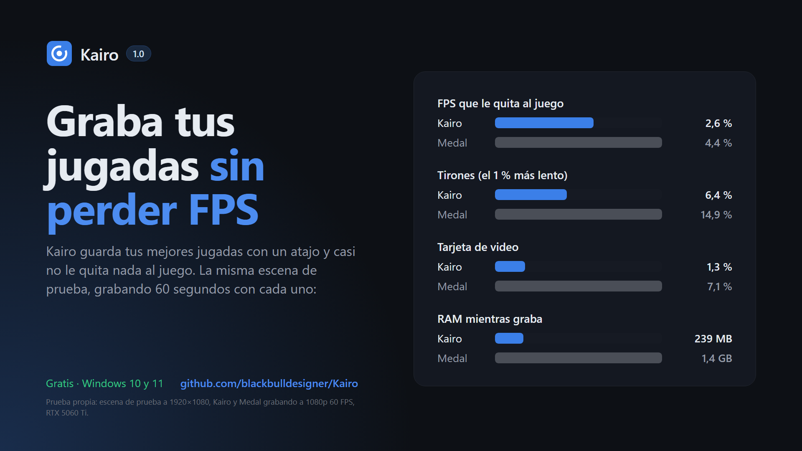

# Kairo

Grabador de clips instantáneos para Windows 10 y 11. Graba en segundo plano y, con una tecla, guarda
los últimos segundos como MP4. Está pensado para que el juego no pierda FPS, tanto en laptops como en
PCs de escritorio.



> **Kairo 1.0.** Graba en segundo plano y guarda los últimos segundos con F9, sin que el juego lo note.
> Detecta el juego, puede grabar solo el juego y separa en pistas el audio del juego, del resto del sistema,
> del micrófono y de los programas que elijas (Discord, música…). Tiene biblioteca de clips con reproductor
> propio, editor (recortar y el volumen de cada pista), compresor, fotos y copias para Discord. Funciona
> también en laptops con dos tarjetas, en tarjetas sin encoder (por procesador) y baja la calidad con batería.
> Las imágenes para compartirlo están en [`promo/`](promo).

## Cómo se usa

- Instálalo con `KairoSetup-<versión>.exe`: se instala solo para tu usuario, sin pedir permisos de
  administrador, en `%LOCALAPPDATA%\Programs\Kairo`, con acceso en el menú Inicio y (si quieres) en el
  escritorio. Para actualizar, abre el instalador de la versión nueva: tus ajustes y tus clips se conservan.
  Como el exe todavía no tiene firma digital, Windows puede avisar "Windows protegió su PC": *Más
  información → Ejecutar de todas formas*.
- Cuando sale una versión nueva, Kairo te avisa junto al reloj y en su ventana: "Actualizar" la baja de
  GitHub, comprueba que sea idéntica a la publicada (SHA-256) y la instala sola. Se puede apagar en Acerca de.
- Para desinstalar: Configuración → Aplicaciones → Kairo. Pregunta si borrar también tus ajustes; los clips
  nunca se borran.
- Abre Kairo: aparece el ícono de Kairo junto al reloj y se abre la ventana de Kairo en la Biblioteca.
- En la Biblioteca, un clic abre el clip en el reproductor de Kairo (Espacio pausa, ← → saltan 5 s). En
  **Editar** lo recortas y cambias el volumen de cada pista (por ejemplo, sin Discord) y en **Comprimir** lo
  achicas para compartir (también "Para Discord": menos de 20 MB). Siempre se guarda como clip nuevo.
- **A Discord:** clic derecho en el clip → **Copiar para Discord** y pégalo en el chat con Ctrl+V. Si pesa más de
  20 MB (lo que deja subir Discord sin Nitro), Kairo primero achica una copia (sin tocar el clip) y la deja copiada.
  Las copias quedan en la categoría **Para Discord** de la Biblioteca y se borran solas (Guardado → Copias para
  Discord: 15 min, 1 hora o 1 día).
- **Fotos:** con el atajo **Sacar foto** (en Atajos) guardas una foto de lo que se está grabando (PNG); aparece en la
  Biblioteca con los clips y se abre con el visor de fotos de Windows.
- **Varios a la vez:** arrastra con el mouse para dibujar un recuadro, como en el escritorio (con Ctrl se suma a lo
  que ya elegiste), o usa Ctrl+clic o el círculo de cada tarjeta. La barra de arriba los manda juntos a la Papelera.
- **F9** guarda los últimos segundos como MP4 (por defecto en `Videos\Kairo`). Suena un aviso corto y aparece un
  cartelito arriba a la derecha por 2 segundos, que no sale en los clips (Guardado → Aviso en pantalla; apagado,
  queda solo el sonido).
- En una laptop desenchufada, Kairo graba a 720p, 30 FPS y calidad Ligera (Grabación → Ahorro con batería).
- Con un segundo atajo ("Guardar clip largo", en Atajos) guardas un clip más largo (por ejemplo, 2 min) por si la
  jugada empezó antes. La RAM la marca el más largo de los dos; con el interruptor **Clip largo** apagado no usa
  RAM de más.
- Clic derecho en el ícono: guardar, pausar, abrir la carpeta de clips, ajustes y salir.
- En la Biblioteca, la estrella marca un clip como favorito. En Guardado → **Limpieza automática** Kairo borra
  solo los clips viejos (más de N días, o los más viejos si todos juntos pasan de X GB), a la Papelera o del todo.
  Nunca borra favoritos ni videos que no hizo Kairo.
- En Grabación puedes elegir si el mouse aparece en tus clips (**Mostrar el mouse**, apagado de fábrica).
- En Grabación → **Opciones avanzadas** puedes elegir el bitrate, si es variable o constante, cada cuánto va
  un cuadro clave, el perfil H.264, la velocidad del encoder, la calidad del audio y el formato: **HEVC** pesa
  cerca de un 40 % menos con la misma calidad (si la tarjeta lo comprime), pero Windows necesita "Extensiones de
  video HEVC" para mostrarlo (VLC no). AV1 no está: el MP4 de Windows 10 no lo termina de escribir.
- En Sistema puedes activar **Iniciar con Windows**.
- **Acerca de** muestra la versión exacta del exe (commit y fecha) y la lista de novedades. Debajo del nombre,
  en el menú, siempre se ve la versión corta (por ejemplo `v0.2.0 · b820923`).

## Cómo funciona

```
Monitor ─Desktop Duplication (o Windows Graphics Capture)─▶ BGRA (GPU) ─procesador de video─▶ NV12 (GPU)
                                                                   │
                       encoder H.264 por hardware (o el de Windows por procesador, 1080p30 como máximo)
                                                                   ▼
Sonido del sistema (WASAPI loopback) ─▶ PCM 48 kHz ─▶  buffer en RAM (últimos N s)
                                                                   │ F9
                                                                   ▼
                                                  MP4 (video copiado tal cual + audio AAC)
```

Un mismo exe tiene varios modos: sin argumentos es la grabadora en la bandeja (y abre los ajustes),
`--fondo` es la grabadora sin ventanas (inicio con Windows) y `--ajustes` es la ventana de ajustes, un
proceso aparte que solo existe mientras está abierta. Se comunican con mensajes de Windows y con
`%APPDATA%\Kairo\estado.json`.

El instalador es ese mismo exe con otro nombre: si se llama `KairoSetup…` (o se abre con `--instalar`)
muestra la ventana de instalación y se copia a sí mismo. `--instalar --sin-ventana` actualiza el Kairo
instalado sin preguntar (conserva el acceso del escritorio y el inicio con Windows) y `--desinstalar` es
el desinstalador.

## Principios

- **Nada dentro del juego:** sin overlay y sin inyectar nada. Así tampoco hay problemas con los anti-trampas.
- **Sin navegador escondido** (nada de Electron ni WebView). El proceso que graba solo tiene el ícono de la
  bandeja; la ventana de ajustes es un proceso aparte que solo existe mientras la tienes abierta.
- **El video nunca sale de la tarjeta de video:** captura, conversión y compresión por hardware.
- **Nada se escribe al disco** hasta que aprietas la tecla.
- **Sin telemetría ni cuentas.**

## Plan

- [ ] **Fase 0: datos de las laptops.** Cada amigo abre Kairo → Sistema → *Copiar diagnóstico* y lo
  comparte, junto con sus FPS sin grabar y con Medal (medidos con PresentMon o CapFrameX).
- [x] **Fase 1: grabadora mínima.** Ícono en la bandeja, tecla global (F9) para guardar, captura del monitor,
  encoder H.264 por hardware, buffer en RAM y MP4 con el audio del sistema.
- [x] **Fase 2: laptops primero.** Captura de respaldo (Windows Graphics Capture) para laptops con dos tarjetas,
  elegir con qué tarjeta grabar, grabación por procesador si la tarjeta no tiene encoder, ahorro con batería y
  cola de cuadros (no se saltan cuadros si el encoder se demora). Queda por medir en laptops reales; la
  prioridad baja en la GPU queda como experimento para cuando haya mediciones.
- [x] **Fase 3: audio y juegos.** Detecta el juego (pantalla completa) o se elige a mano; sigue al juego de
  monitor; "Solo el juego" deja el clip en negro con Alt+Tab; audio solo del juego, resto del sistema sin el
  juego y micrófono; pistas separadas opcionales (la mezcla siempre primero); carpeta y nombre por juego; la
  ventana de ajustes crece con la ventana.
- [x] **Fase 3b: audio por programa.** "Otros sonidos": todo lo demás, o solo los programas que elijas con "+"
  (Discord, música…), cada uno con su volumen y su pista. Cada clip guarda al lado un archivo oculto
  (`clip.mp4.kairo`) con el juego y los nombres de las pistas, para la biblioteca y el editor.
- [x] **Fase 4: biblioteca de clips.** Cuadrícula con miniatura, duración, juego, tamaño y fecha; filtro por juego,
  búsqueda y orden; abrir, mostrar en la carpeta, renombrar y mandar a la Papelera. Las miniaturas se generan en
  segundo plano y quedan en caché (`%APPDATA%\Kairo\miniaturas`). Vive en la ventana de Kairo: no pesa nada
  mientras juegas.
- [x] **Fase 5: editor.** Reproductor dentro de Kairo (con WASAPI y el volumen de cada pista en vivo), recorte
  sin recodificar el video (desde el cuadro clave anterior), volumen o silencio por pista usando los datos de
  cada clip, y compresor (1080p, 720p o menos de 20 MB) con el encoder de la tarjeta y prioridad baja.
- [ ] **Fase 6: extras.** ~~Instalador~~ (listo: `KairoSetup.exe`, sin permisos de administrador, con
  desinstalador en "Aplicaciones instaladas"), ~~actualizaciones~~ (listo: aviso y actualización con
  SHA-256), ~~aviso en pantalla, fotos y copias para Discord~~ (listos en la 1.0) y firma digital.

## Kairo contra Medal

La meta era perder menos FPS que Medal y 3 % o menos. Prueba propia (20/11/2026): la misma escena de prueba a
1920×1080, pesada y sin límite de FPS (~200 FPS sin grabar), 60 s grabando con cada uno a 1080p 60 FPS con
H.264 de la tarjeta, en una PC con RTX 5060 Ti. "Sin nada" es el promedio de una ronda al principio y otra al
final (dieron casi igual: la PC no se calentó).

| | FPS | FPS que le quita | 1 % más lento (tirones) | Le quita | Procesador | Tarjeta | Encoder | RAM |
|---|---|---|---|---|---|---|---|---|
| Sin nada | 202,7 | – | 186,9 | – | – | – | – | – |
| **Kairo** | **197,5** | **2,6 %** | **175,0** | **6,4 %** | **0,01 %** | **1,3 %** | 7,5 % | **239 MB** |
| Medal | 193,7 | 4,4 % | 159,0 | 14,9 % | 0,37 % | 7,1 % | 9,4 % | 1410 MB |

Procesador = de toda la PC; tarjeta y encoder = uso de esos motores de la tarjeta; RAM = memoria privada (en Medal,
con su ventana, que tiene que estar abierta para grabar). Para repetirla en otra PC:
`powershell -ExecutionPolicy Bypass -File scripts\comparar-fps.ps1` (unos 5 minutos; pide abrir y cerrar Medal,
que tiene que grabar la pantalla completa). Falta medir en laptops reales (Fase 0).

## Compilar

Necesitas [Rust](https://rustup.rs) en Windows.

```powershell
cargo build --release
```

El exe queda en `target\release\kairo.exe`.

Para armar el instalador (compila y deja `dist\KairoSetup-<versión>.exe`):

```powershell
powershell -ExecutionPolicy Bypass -File scripts\instalador.ps1
```

Para publicar una versión (los Kairo instalados la detectan solos): sube `version` en `Cargo.toml`, haz
commit y corre el script. Necesita [GitHub CLI](https://cli.github.com) (`gh`). Sube la rama y crea el
release `v<versión>` con el instalador y su `.sha256`:

```powershell
powershell -ExecutionPolicy Bypass -File scripts\publicar.ps1
```

Para desarrollo hay una opción que guarda una imagen de una página de los ajustes (sirve para revisar la
interfaz sin abrirla a mano):

```powershell
cargo run --features dev -- --captura-ui sistema captura.png
```

Las páginas son `grabacion`, `audio`, `clips`, `atajos` y `sistema`.

Con `--features dev` también hay pruebas de la grabadora sin ventanas:

```powershell
cargo run --features dev -- --prueba-grabar 6 prueba.mp4
cargo run --features dev -- --prueba-leer prueba.mp4 cuadro.png
```

La primera graba 6 segundos (con un tono a la mitad) y guarda el clip; la segunda lo abre como un reproductor,
cuenta cuadros, mide el audio y guarda la imagen del cuadro del medio. `--prueba-medios clip.mp4` prueba el
reproductor, el recorte y el compresor con ese clip (deja al lado el clip "(editado)" y el "(comprimido)").

El instalador se prueba en una carpeta aparte, sin tocar la PC (otra clave del registro, sin cerrar el Kairo
abierto ni tocar el inicio con Windows):

```powershell
$env:KAIRO_PRUEBA_INSTALACION = "$env:TEMP\kairo-prueba"
cargo run --features dev -- --prueba-instalar
cargo run --features dev -- --prueba-desinstalar
cargo run --features dev -- --captura-instalador instalador.png
```

## Archivos del usuario

- Programa (instalado): `%LOCALAPPDATA%\Programs\Kairo\Kairo.exe`
- Ajustes: `%APPDATA%\Kairo\config.json`
- Estado de la grabadora: `%APPDATA%\Kairo\estado.json`
- Registro (para entender fallas): `%APPDATA%\Kairo\kairo.log`
- Miniaturas de la biblioteca: `%APPDATA%\Kairo\miniaturas`
- Última búsqueda de actualizaciones: `%APPDATA%\Kairo\actualizacion.json`
- Datos de cada clip (juego y pistas): `clip.mp4.kairo`, oculto al lado del video
- Clips: `Videos\Kairo` (se puede cambiar en la página Clips)

## Licencia

[GPL-3.0-or-later](LICENSE). Puedes usar, estudiar, cambiar y compartir Kairo; si compartes una versión
modificada, tiene que ser con su código y bajo la misma licencia.

La idea se inspira en otros grabadores de repeticiones instantáneas (como
[Clippy](https://github.com/santiremedi/clippy)), pero el código de Kairo está escrito desde cero.
